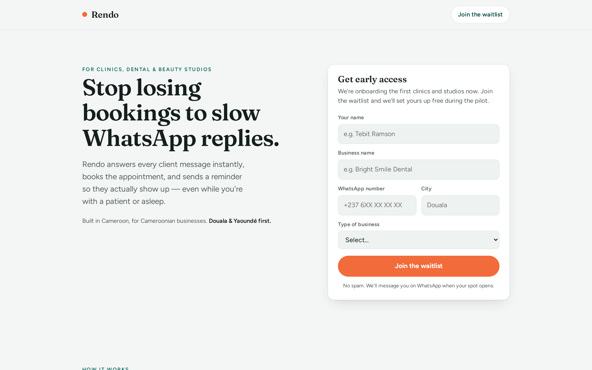

# Rendo

**WhatsApp booking assistant for clinics, dental offices and beauty studios in Cameroon.**
Rendo answers every client message instantly, books the appointment, and sends a reminder so clients show up.

🔗 Live landing page: https://rendo-cm.netlify.app
📍 Status: booking assistant working on the WhatsApp test number; reminders next (see [docs/PROJECT.md](docs/PROJECT.md))



## The problem
Small clinics and salons in Cameroon take most bookings over WhatsApp. When the owner is busy with a client or the business is closed, messages go unanswered and clients book elsewhere. Booked clients also miss appointments; studies of appointment reminders report missed-appointment reductions of around 40%.

## How it works
```
Client's WhatsApp → Meta WhatsApp Cloud API → Supabase Edge Function (webhook)
                                                    ↓
                                     Supabase Postgres (businesses, appointments)
                                                    ↓
                               pg_cron → reminder messages → Client's WhatsApp
```

## Tech stack
| Layer | Technology |
|---|---|
| Landing page | HTML, CSS, vanilla JavaScript (Netlify) |
| Database | Supabase Postgres with Row Level Security |
| Backend | Supabase Edge Functions (Deno, TypeScript) |
| Messaging | WhatsApp Cloud API (Meta Graph API v25.0) |
| Scheduling | pg_cron + pg_net (planned, M4) |

## Security decisions
- **Row Level Security** on every table. The landing page's Supabase key is a *publishable* key, safe to be public, because RLS only allows inserting a signup, never reading the list.
- **Webhook signature check.** Every request is verified with HMAC-SHA256 (`X-Hub-Signature-256`) using the Meta app secret, with a constant-time comparison.
- **Secrets** live in Supabase's secret store, never in this repository.
- **Privacy.** The webhook logs message types only, never message content. Rendo stores booking details only, never medical information (Cameroon Law No. 2024/017 on personal data protection).

## Documentation
- **[docs/PROJECT.md](docs/PROJECT.md)** — the full handbook: architecture, database, conversation rules,
  security, how to test/deploy, roadmap and known gaps. Start here.
- [docs/RESEARCH.md](docs/RESEARCH.md) — verified facts and the reasons behind each decision.
- [docs/templates.md](docs/templates.md) — WhatsApp message templates.

## Project structure
```
web/                                   Landing page, waitlist, privacy policy
supabase/migrations/                   Database schema 0001–0012 (applied in order)
supabase/functions/whatsapp-webhook/   WhatsApp webhook (entry point + HTTP handling)
supabase/functions/_shared/            Conversation, understanding, availability, i18n, database access
supabase/functions/tests/              117 Deno tests  →  deno test supabase/functions/tests/
supabase/tests/                        SQL tests (run in Supabase SQL Editor, end with ROLLBACK)
supabase/seed/demo_business.sql        Demo salon on the Meta test number
```

## Roadmap
- [x] Market research and positioning
- [x] Landing page and waitlist (live)
- [x] WhatsApp webhook: signature check, deduplication (M0)
- [x] Booking schema with no double booking, availability engine (M1–M2)
- [x] Booking conversation in French/English with buttons, lists and typed requests; cancel; talk to a person; owner alerts (M3–M3.7)
- [x] Salon catalogue: styles with questions (size, length, hair), chairs, price display setting
- [ ] Automatic reminders + privacy clean-up jobs (M4, next)
- [ ] Owner commands and catalogue editing on WhatsApp (M5)
- [ ] First pilot businesses (M6)

## Author
**Tebit Ramson Titih**, software engineering student, Cameroon.
